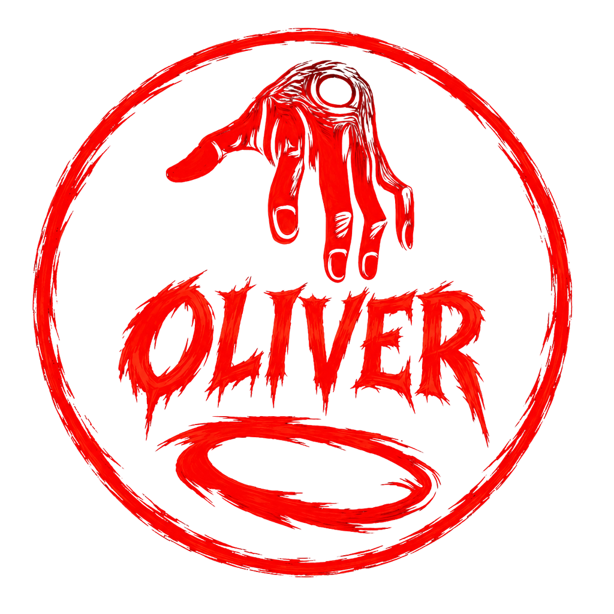

<p align="center"></p>

# OLIVER

Keyboard & mouse mapper for mobile games.

## Status
- [x] Bottom-nav app: **Start Game** (games list, Add Game, mouse/keyboard badges), Account, Settings
- [x] Start Game: overlay permission -> foreground session -> floating ball, side menu, HUD (battery / time)
- [x] Edit keymap: Exit · Add component · Save · Share · Import (10 component types)
- [x] Bind any key / mouse button / wheel, 16 functions, conflict checker, per-game profiles
- [x] Free Fire preset
- [x] Server skeleton (`app_process` + InputManager touch injection) and Termux activation script
- [ ] Wire `InputRouter`: physical key/mouse events -> components -> `IpcClient` -> `TouchInjector`
- [ ] FPS / ping / net-speed monitors, macro engine, keyboard typing panel, keymap configs

## Build on GitHub
Push to `main`; the **Build OLIVER APK** workflow uploads `OLIVER-debug-apk` (Actions -> run -> Artifacts).

## Activation (Termux)
See `scripts/oliver-activate.sh` and the Activation screen (Settings tab).

## Layout
```
app/src/main/java/com/jerry/oliver/
├── MainActivity.kt
├── ui/        games, account, settings, status
├── session/   GameLauncher, SessionService
├── overlay/   OverlayManager, FloatingBall, RadialMenu, HudBar
├── editor/    EditorActivity, EditorView, AddComponentDialog, BindingDialog
├── components/ComponentType
├── keymap/    model, KeyCatalog, ConflictChecker, KeymapStore, KeymapRepository
├── input/     CameraLookHandler, DeviceMonitor
├── server/    Main, TouchInjector, IpcProtocol, IpcClient
├── activation/ActivationActivity, ServerLauncher
├── games/     GameRepository, InstalledApps
├── monitor/   BatteryMonitor
├── macro/ tools/ util/
```
